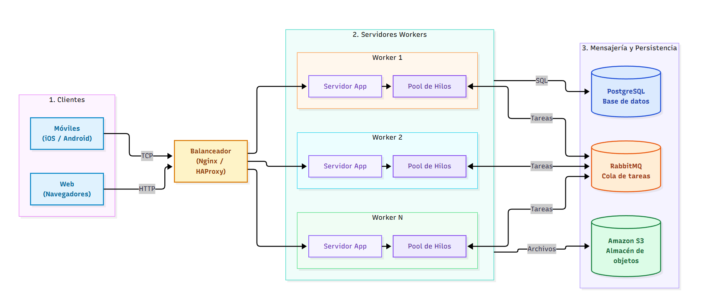

# TP3: Plataforma Distribuida de Procesamiento de Tareas mediante Sockets TCP

Solución distribuida basada en el paradigma cliente-servidor para el despacho, ejecución y persistencia de tareas en red. El servidor recepciona solicitudes concurrentes a través de sockets TCP, las encola de manera sincronizada y las delega a un conjunto de hilos trabajadores (*worker pool*), devolviendo los resultados correspondientes a cada cliente emisor de forma no bloqueante.

El sistema incorpora control de acceso con registro y login de usuarios, almacenamiento seguro de credenciales mediante hashes `bcrypt` y persistencia relacional en SQLite.

---

## Tecnologías Empleadas

* **Python 3**: Entorno principal de desarrollo.
* **`socket`**: Comunicación de red bidireccional sobre flujo TCP.
* **`threading`**: Concurrencia multihilo (un hilo por cliente conectado y un conjunto de workers paralelos).
* **`queue.Queue`**: Cola compartida y segura para hilos (*thread-safe*) para el reparto de tareas.
* **`json`**: Formato estándar de serialización de mensajes delimitados por saltos de línea (`\n`).
* **`sqlite3`**: Motor de base de datos relacional integrado (`tareas.db`).
* **`bcrypt`**: Hashing criptográfico con salt para la protección de contraseñas.

---

## Estructura del Proyecto

```text
tp3-redes/
├── servidor.py        # Servidor TCP multihilo con pool de workers y acceso a base de datos
├── cliente.py         # Cliente interactivo de consola para envío de tareas y recepción de resultados
├── DIAGRAMA.md        # Arquitectura distribuida del sistema (diagrama interactivo Mermaid)
├── diagrama.png       # Representación gráfica exportada de la arquitectura
├── requirements.txt   # Dependencias de paquetes externos (bcrypt)
├── .gitignore         # Reglas de exclusión para Git
└── README.md          # Manual y documentación técnica del proyecto
```

---

## Arquitectura y Flujo de Operación (ver diagrama.md)

```text
[ Cliente 1 ] ──┐                                 ┌──> [ Worker 1 ] ──┐
[ Cliente 2 ] ──┼──> [ Servidor TCP ] ──> [ Cola ] ┼──> [ Worker 2 ] ──┼──> Respuesta al cliente origen
[ Cliente N ] ──┘     (Hilo por cliente)          └──> [ Worker N ] ──┘
                                                            │
                                                     [ SQLite DB ]
```



1. **Recepción de conexiones:** El servidor se vincula a la dirección `127.0.0.1:5001`. Por cada cliente entrante se inicializa un hilo dedicado a escuchar sus peticiones.
2. **Buffer de trabajo:** Cada solicitud JSON recibida y validada se deposita en una cola en memoria (`queue.Queue`).
3. **Pool de trabajadores:** Un grupo de hilos independientes (4 workers configurados en `CANTIDAD_WORKERS`) toma las tareas disponibles en la cola de forma concurrente.
4. **Respuesta sincronizada:** Una vez resuelta la petición, el worker transmite el resultado de vuelta al socket del cliente original. Se emplea un cerrojo (`threading.Lock`) por conexión para impedir colisiones o intercalado de datos cuando varios workers responden simultáneamente al mismo cliente.
5. **Recepción asíncrona:** El cliente procesa las respuestas entrantes en un hilo en segundo plano. Como el tiempo de resolución puede variar, cada pedido cuenta con un identificador correlativo (`id`) para emparejar cada respuesta con su solicitud correspondiente.
6. **Autenticación sin estado:** Al iniciar sesión, el servidor emite un `token` de acceso. Dado que cualquier worker del pool puede resolver cualquier tarea, las operaciones privadas se autorizan validando el token enviado en la carga útil.

---

## Guía de Instalación y Uso

### 1. Clonar el repositorio y acceder al proyecto

```bash
git clone <URL_DEL_REPOSITORIO>
cd <CARPETA_DEL_PROYECTO>
```

### 2. Configurar el entorno virtual e instalar librerías

```bash
python -m venv venv
# En Windows:
venv\Scripts\activate
# En Linux / macOS:
# source venv/bin/activate

pip install -r requirements.txt
```

### 3. Iniciar el servidor central

```bash
python servidor.py
```

*El servidor inicializará la base de datos `tareas.db` y quedará a la espera de conexiones en el puerto 5001 con su pool de workers activo.*

### 4. Lanzar el cliente (se pueden abrir múltiples terminales en simultáneo)

```bash
python cliente.py
```

Menú interactivo disponible:
```text
--- Cliente de tareas (sockets) ---
1. Registrarse
2. Iniciar sesión
3. Crear tarea
4. Ver tareas
5. Completar tarea
6. Eliminar tarea
7. Generar reportes en paralelo
8. Cerrar sesión
9. Salir
```

---

## Especificación del Protocolo de Red

La comunicación se implementa mediante objetos JSON estructurados en una única línea, finalizados por el carácter de salto de línea (`\n`).

### Estructura de una Solicitud (Request):
```json
{
  "id": 3,
  "tipo": "crear_tarea",
  "token": "4f8a12bc...",
  "datos": {
    "titulo": "Revisar arquitectura",
    "descripcion": "Verificar comunicación entre workers"
  }
}
```

### Estructura de Respuesta Exitosa (Response OK):
```json
{
  "estado": "ok",
  "mensaje": "Tarea creada correctamente",
  "tarea_id": 1,
  "id": 3,
  "worker": "worker-2"
}
```

### Estructura de Respuesta con Error (Response Error):
```json
{
  "estado": "error",
  "error": "Sesión no válida o no autenticado",
  "id": 3,
  "worker": "worker-1"
}
```

---

## Operaciones Soportadas

| Tipo de Acción | Campos requeridos en `datos` | Requiere Token | Resultado Producido |
| :--- | :--- | :---: | :--- |
| `registro` | `usuario`, `contraseña` | No | Da de alta el usuario en la base de datos con contraseña hasheada. |
| `login` | `usuario`, `contraseña` | No | Valida credenciales y retorna un `token` de sesión hexadecimal. |
| `logout` | Ninguno | Sí | Invalida el token activo en el registro de sesiones del servidor. |
| `crear_tarea` | `titulo`, `descripcion` *(opcional)* | Sí | Registra la nueva tarea y retorna su `tarea_id`. |
| `listar_tareas` | Ninguno | Sí | Retorna la colección `tareas` asociadas al usuario autenticado. |
| `completar_tarea` | `tarea_id` | Sí | Actualiza el estado de la tarea a completada (`1`). |
| `eliminar_tarea` | `tarea_id` | Sí | Remueve el registro de la tarea de la base de datos. |
| `generar_reporte` | Ninguno | Sí | Ejecuta un cálculo simulado lento (2 segundos) con métricas de tareas. |

*Cualquier solicitud con formato inválido, tipo desconocido o parámetros incorrectos es respondida con `"estado": "error"` sin provocar la caída del socket.*

---

## Demostración del Procesamiento Paralelo

Para verificar el funcionamiento y balanceo del pool de workers:

1. Iniciar sesión en el cliente.
2. Seleccionar la opción **7. Generar reportes en paralelo**.
3. Indicar el envío simultáneo de, por ejemplo, **4 reportes**.

Dado que cada reporte simula una carga de cómputo de 2 segundos:
* Si el servidor fuese monohilo/secuencial, el tiempo total sería de 8 segundos ($4 \times 2\text{ s}$).
* Al contar con 4 workers en paralelo, cada hilo toma un reporte a la vez y la totalidad de los resultados retorna en **~2.0 segundos**:

```text
4 reportes despachados, esperando resultados...
  [ 2.0s | worker-2] total=1 completadas=1 pendientes=0
  [ 2.0s | worker-4] total=1 completadas=1 pendientes=0
  [ 2.0s | worker-1] total=1 completadas=1 pendientes=0
  [ 2.0s | worker-3] total=1 completadas=1 pendientes=0
Tiempo total: 2.0s
```

---

## Correspondencia con la Arquitectura Distribuida

La conceptualización formal del sistema distribuido a gran escala (clientes, balanceador de carga Nginx/HAProxy, nodos workers, cola de mensajería RabbitMQ y persistencia en PostgreSQL y Amazon S3) se encuentra detallada en [DIAGRAMA.md](DIAGRAMA.md).

Para el alcance de esta implementación práctica en entorno local, los componentes del modelo teórico se mapean de la siguiente manera:

| Componente del Diagrama Teórico | Equivalente en la Implementación Local |
| :--- | :--- |
| **Clientes (Móviles / Web)** | Instancias de `cliente.py` ejecutándose en múltiples terminales |
| **Balanceador de Carga / Ingress** | Hilo despachador de conexiones entrantes en `servidor.py` |
| **Servidores Workers y Pools** | Hilos concurrentes `worker-1` a `worker-N` |
| **Cola de Mensajes Distribuida (RabbitMQ)** | Estructura en memoria sincronizada `queue.Queue` |
| **Almacenamiento Distribuido (PostgreSQL / S3)** | Base de datos relacional local SQLite (`tareas.db`) |

---
